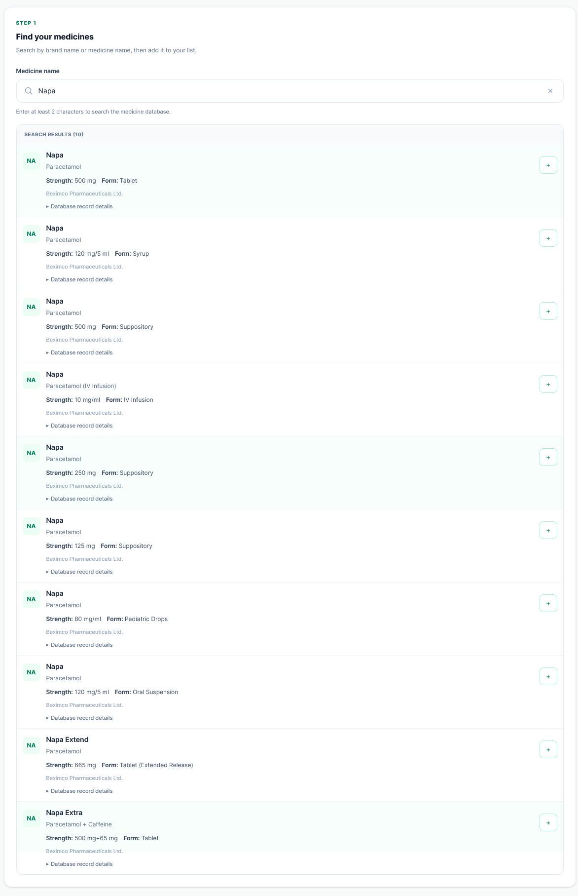
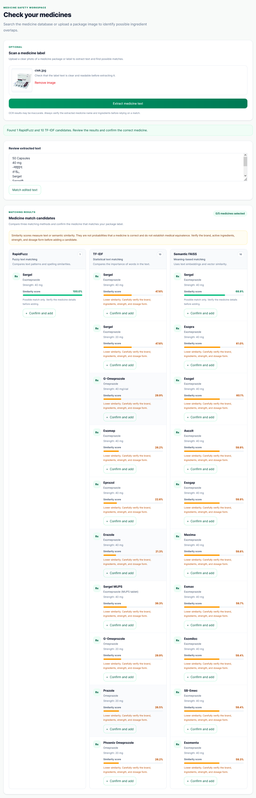
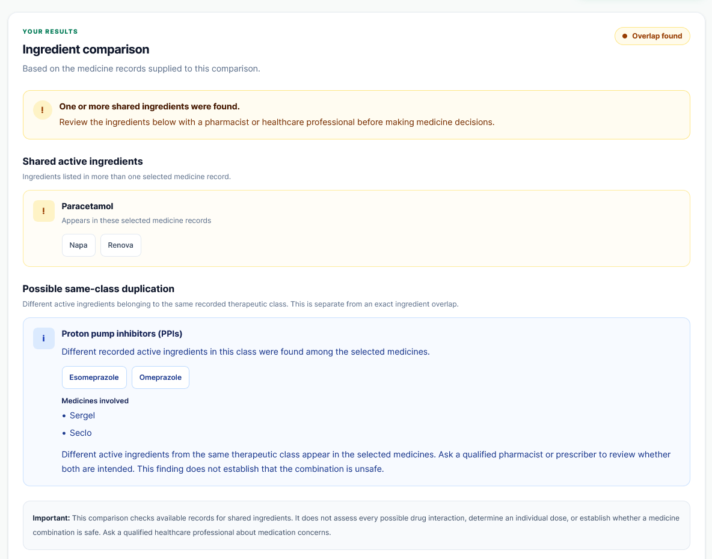
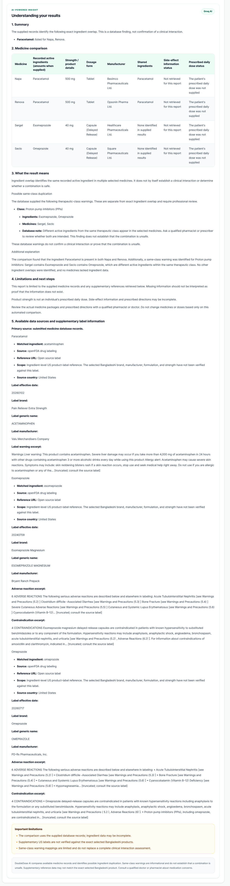

# DoubleDose AI

### AI-Powered Medicine Ingredient & Interaction Checker

DoubleDose AI is an AI-assisted medicine information platform designed to help users inspect medicine ingredients, identify potential ingredient overlaps, and understand medicine information through OCR, intelligent medicine matching, and AI-generated explanations.

The project focuses on improving access to medicine information through a searchable catalogue of Bangladeshi medicines and a user-friendly medicine comparison workflow.

> **Safety notice:** DoubleDose AI is an informational prototype, not a medical diagnostic system. Its results do not establish whether a medicine combination is safe. Always consult a qualified pharmacist or healthcare professional before combining medicines or changing treatment.

---

## Live Application

- **Frontend:** https://doubledose-ai.vercel.app
- **Backend API:** https://doubledose-ai-api.onrender.com
- **Interactive API documentation:** https://doubledose-ai-api.onrender.com/docs

---

## Demo Video

Watch the DoubleDose AI demonstration to see the main application workflow, including medicine search, OCR-based identification, candidate matching, ingredient overlap detection, and AI-generated explanations.

**Demo video:** [Watch the DoubleDose AI Demo](YOUR_GOOGLE_DRIVE_DEMO_VIDEO_LINK)

> Replace `YOUR_GOOGLE_DRIVE_DEMO_VIDEO_LINK` with your actual Google Drive sharing link before submission. Ensure the video permissions allow reviewers to view it.

---

## Features

### 1. Medicine Search

- Search a catalogue of Bangladeshi medicines.
- View medicine names, generic ingredients, strengths, dosage forms, and available manufacturer information.
- Select multiple medicines for ingredient comparison.
- Review candidate information before proceeding.

### 2. Ingredient Overlap Detection

- Compare the ingredients of selected medicines.
- Identify shared ingredients when the available catalogue data supports the comparison.
- Present potential overlap findings and relevant medicine information.
- Report incomplete ingredient data where applicable.

A lack of detected overlap does not establish that a combination is safe. Different medicines can interact even when they have no shared active ingredient.

### 3. OCR-Based Medicine Identification

- Upload medicine-label images in supported formats.
- Extract text from medicine packaging using Tesseract OCR and an OCR.space fallback where configured.
- Edit extracted text before searching for medicine candidates.
- Retrieve potential medicine matches for user confirmation.

Supported frontend upload formats include JPEG, PNG, and WebP, with a maximum upload size of 10 MB.

OCR results may contain spelling errors, incomplete ingredient names, or incorrect strength values. Users should verify extracted information against the original packaging.

### 4. Multiple Medicine-Matching Approaches

DoubleDose AI includes three candidate-retrieval approaches:

| Matcher        | Approach                                                                                   |
| -------------- | ------------------------------------------------------------------------------------------ |
| RapidFuzz      | Fuzzy text matching for medicine names and OCR-extracted text                              |
| TF-IDF         | Lexical similarity using text-vector representations                                       |
| Semantic FAISS | Sentence Transformers embeddings, FAISS similarity search, and medicine-specific reranking |

The semantic matcher uses the configurable Sentence Transformers model, defaulting to `sentence-transformers/all-MiniLM-L6-v2`.

Semantic candidates can be reranked using evidence such as brand name, generic ingredients, manufacturer, strength, and dosage form.

Matcher scores are ranking signals, not calibrated probabilities that a medicine has been identified correctly. Candidate confirmation remains important.

### 5. AI-Generated Explanations

- Uses the Groq API to generate explanations of medicine overlap findings.
- Helps users understand relevant ingredient information in plain language.
- Integrates structured application data with AI-generated explanatory text.
- Supports more understandable presentation of potential overlap findings.

AI-generated explanations may be incomplete or incorrect. They should not be treated as a clinical diagnosis, prescription, or substitute for professional advice.

### 6. Medicine Information and Safety Context

The application can use available medicine-catalogue information and configured external medicine-information sources, including openFDA integration, where supported.

The availability and completeness of external information depend on the configured data sources and the medicine being searched.

### 7. Evaluation and Experiment Tracking

- Evaluates RapidFuzz, TF-IDF, and Semantic FAISS using a shared matcher evaluation script.
- Calculates Top-1 accuracy, Top-3 accuracy, Mean Reciprocal Rank at 3 (MRR@3), no-candidate rate, and average query time.
- Generates JSON and Markdown evaluation reports.
- Supports MLflow experiment tracking when MLflow is installed and tracking succeeds.
- Includes evaluation hooks for synthetic text, synthetic rendered images, and labelled real photographs.

---

## Technology Stack

### Frontend

- Next.js
- React
- TypeScript
- Tailwind CSS
- Redux Toolkit
- REST API integration

### Backend

- Python
- FastAPI
- SQLAlchemy
- Pydantic
- PostgreSQL
- Neon PostgreSQL hosting

### AI, NLP, and OCR

- Groq API for AI-generated explanations
- Sentence Transformers for semantic embeddings
- FAISS for vector similarity search
- RapidFuzz for fuzzy string matching
- TF-IDF for lexical similarity
- Tesseract OCR for text extraction
- OCR.space as a configured OCR fallback
- openFDA integration for supported external medicine information
- MLflow for experiment tracking

### Deployment

- Vercel for the frontend
- Render for the backend
- Neon for the PostgreSQL database

---

## Latest Medicine-Matcher Benchmark

The latest recorded evaluation was run on October 28, 2026, using:

```bash
python -m scripts.evaluate_medicine_matchers
```

The evaluation used five manually written, clean-text cases, with a top-three candidate cutoff.

| Metric            | RapidFuzz | TF-IDF | Semantic FAISS |
| ----------------- | --------: | -----: | -------------: |
| Evaluation cases  |         5 |      5 |              5 |
| Top-1 accuracy    |       80% |    80% |           100% |
| Top-3 accuracy    |      100% |   100% |           100% |
| MRR@3             |      0.90 |   0.90 |           1.00 |
| No-candidate rate |        0% |     0% |             0% |
| Mean query time   |    5.65 s | 5.62 s |         0.38 s |

### Understanding the metrics

- **Top-1 accuracy:** The proportion of cases where the expected medicine brand appears first.
- **Top-3 accuracy:** The proportion of cases where the expected brand appears among the first three candidates.
- **MRR@3:** The mean reciprocal rank of the expected brand within the first three candidates.
- **No-candidate rate:** The proportion of queries for which no candidates are returned.
- **Mean query time:** The average measured query duration during the recorded run.

The reported Top-1 accuracy confidence intervals were:

| Matcher        | Wilson 95% confidence interval |
| -------------- | ------------------------------ |
| RapidFuzz      | 37.6%–96.4%                    |
| TF-IDF         | 37.6%–96.4%                    |
| Semantic FAISS | 56.6%–100%                     |

### Interpretation

Semantic FAISS ranked the expected brand first in all five cases in this run. RapidFuzz and TF-IDF each ranked the expected brand first in four of five cases. All three approaches returned the expected brand within their top three candidates for all five cases.

These are **preliminary results, not a comprehensive accuracy evaluation**. Five clean-text examples are insufficient to establish general performance on unseen medicines, real packaging photographs, or noisy OCR output.

Query times are environment-dependent and may vary with caching, model initialization, hardware, and system load. They should not be interpreted as guaranteed production latency.

### Reproducing the evaluation

From the backend directory, activate the Python virtual environment and run:

```powershell
python -m scripts.evaluate_medicine_matchers
```

The evaluator generates:

- `backend/evaluation/results/matcher_report.json`
- `backend/evaluation/results/matcher_report.md`

The evaluator also supports additional synthetic-text, synthetic-image, and labelled real-photo datasets. Results for those datasets should be generated separately before claiming that those evaluations have been completed.

---

## Application Screenshots

The following screenshots are stored in `docs/images/` in the repository.

### Medicine Search



### OCR-Based Medicine Identification



### Ingredient Overlap Results



### AI-Generated Explanation



---

## Project Structure

The repository is organized into frontend, backend, documentation, and evaluation components.

```text
doubledose-ai/
├── LICENSE
├── README.md
├── backend/
│   ├── app/
│   │   ├── api/
│   │   ├── core/
│   │   ├── db/
│   │   ├── models/
│   │   ├── schemas/
│   │   └── services/
│   ├── evaluation/
│   │   └── results/
│   ├── scripts/
│   ├── requirements.txt
│   └── requirements-ml.txt
├── frontend/
│   ├── app/
│   ├── components/
│   ├── lib/
│   └── types/
└── docs/
    ├── images/
    ├── ai-methodology.md
    └── user-guide.md
```

This is a simplified overview; individual files may vary as the project evolves.

---

## Local Setup

### Prerequisites

- Python 3.11 or another version compatible with the project's dependencies
- Node.js and npm compatible with the frontend configuration
- Git
- PostgreSQL or a Neon PostgreSQL database
- A Groq API key for AI-generated explanations
- An OCR.space API key if using that configured OCR fallback

Tesseract OCR is also required for the local Tesseract workflow. Install it separately and ensure its executable is accessible to the backend configuration.

### 1. Clone the repository

```bash
git clone https://github.com/MasrulSakib/doubledose-ai.git
cd doubledose-ai
```

Replace the placeholder with the actual GitHub repository URL.

### 2. Configure the backend

```bash
cd backend
python -m venv .venv
```

Activate the virtual environment.

**Windows PowerShell:**

```powershell
.\.venv\Scripts\Activate.ps1
```

**macOS/Linux:**

```bash
source .venv/bin/activate
```

Install the dependencies:

```bash
python -m pip install --upgrade pip
pip install -r requirements.txt
```

If the application requires additional machine-learning dependencies, install them too:

```bash
pip install -r requirements-ml.txt
```

Use the dependency files and Python version supported by the current project configuration.

### 3. Configure environment variables

Create a local `.env` file using the variable names expected by the backend configuration.

Example:

```dotenv
DATABASE_URL=your_neon_postgresql_connection_string
GROQ_API_KEY=your_groq_api_key
OCR_SPACE_API_KEY=your_ocr_space_api_key
SENTENCE_TRANSFORMER_MODEL=sentence-transformers/all-MiniLM-L6-v2
```

These are example settings. Verify the exact variable names against the backend configuration; optional services may not require every variable.

Apply database migrations if required by the current database state:

```bash
alembic upgrade head
```

Run the backend from the directory containing `main.py`:

```bash
uvicorn main:app --reload
```

The local API will normally be available at:

- API: http://127.0.0.1:8000
- Swagger documentation: http://127.0.0.1:8000/docs

### 4. Configure the frontend

Open a second terminal:

```bash
cd frontend
npm install
```

Configure the frontend API base URL using the environment variable expected by the API client. For example, if the client uses `NEXT_PUBLIC_API_URL`, create `.env.local`:

```dotenv
NEXT_PUBLIC_API_URL=http://127.0.0.1:8000
```

Check the existing API client and environment configuration to confirm the exact variable name and whether an API prefix is required.

Start the development server:

```bash
npm run dev
```

Open http://localhost:3000 in your browser.

### 5. Run a production build

From the frontend directory:

```bash
npm run build
```

Resolve any build errors before deploying new frontend changes.

---

## Deployment

### Frontend — Vercel

The frontend is deployed on Vercel:

https://doubledose-ai.vercel.app

Configure the frontend API base URL using the variable expected by the application. Ensure it points to the deployed backend and uses the correct API prefix.

### Backend — Render

The backend is deployed on Render:

https://doubledose-ai-api.onrender.com

API documentation:

https://doubledose-ai-api.onrender.com/docs

Configure database credentials, AI API keys, OCR fallback credentials, and other required settings through the hosting provider's environment settings rather than committing secrets to the repository.

### Database — Neon

The application uses Neon PostgreSQL for hosted database storage. Keep the database connection string private and ensure the deployed backend uses the intended database.

---

## Documentation

- [AI methodology](docs/ai-methodology.md) — matching approaches, OCR, AI integration, evaluation metrics, and limitations.
- [User guide](docs/user-guide.md) — instructions for searching medicines, uploading labels, reviewing candidates, and interpreting results.
- [Matcher evaluation report](backend/evaluation/results/matcher_report.md) — generated benchmark results.
- [Matcher evaluation data](backend/evaluation/results/matcher_report.json) — machine-readable benchmark results.
- [Project license](LICENSE) — license terms for the repository.

---

## Limitations and Responsible Use

DoubleDose AI is a prototype intended for medicine-information exploration and demonstration.

- Medicine-catalogue entries may contain incomplete or inconsistent ingredient, strength, dosage-form, or manufacturer information.
- OCR can misread brand names, ingredients, and strengths.
- Candidate-ranking results can be incorrect even when a high score is returned.
- Semantic similarity does not prove that two medicines are equivalent.
- Shared ingredients can be missed when catalogue data is incomplete.
- No shared ingredient does not mean that two medicines are safe to take together.
- AI-generated explanations can omit important context or produce incorrect statements.
- The five-case matcher benchmark is too small to establish general-purpose accuracy.
- This benchmark does not establish clinical safety, therapeutic effectiveness, or trained YOLO detector performance.

Always verify medicine details with the original packaging and consult a qualified pharmacist or healthcare professional for decisions involving medication.

---

## Future Improvements

Potential next steps include:

- Expanding the evaluation dataset with verified medicine labels and realistic OCR errors.
- Testing all three matchers on the same larger, independently labelled dataset.
- Measuring matching performance by dosage form, strength, brand-name variation, and OCR quality.
- Evaluating OCR on real packaging photographs.
- Improving ingredient-data completeness and source tracking.
- Improving confidence calibration and candidate-review workflows.
- Adding more comprehensive tests for the API, frontend, OCR, and matching behavior.
- Improving monitoring, reproducibility, and experiment tracking.

These are potential improvements and should not be interpreted as completed features unless they have been implemented and evaluated.

---

## Author

**Masrul Sakib**

DoubleDose AI was developed as a capstone project exploring the practical use of AI, natural-language processing, OCR, and web technologies to improve access to medicine information.
